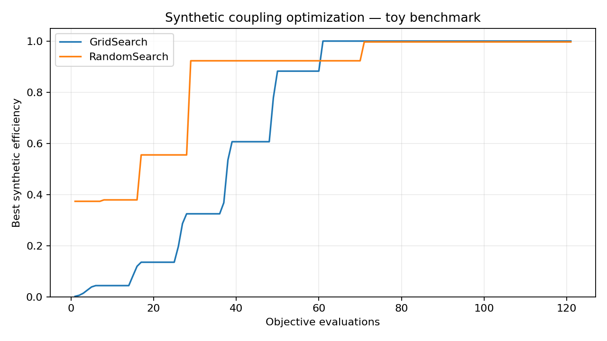

# Photonics Optimization Platform

A modular Python prototype for maximizing optical coupling objectives with **Grid Search**, **Random Search**, and **Bayesian Optimization**. Version 0.3 retains the reproducible synthetic demo and adds an optional Meep 2D FDTD taper backend.

**Scientific scope:** The default demo and CSV fixtures are explicitly synthetic. Optional Meep outputs are actual 2D FDTD calculations with separate provenance; they are unvalidated numerical examples, not a full 3D silicon photonics device or calibrated fabrication predictions. No experimental data is included.

## Quick start

Requires Python 3.10 or newer. From the repository root:

```bash
python -m venv .venv
source .venv/bin/activate  # Windows: .venv\Scripts\activate
python -m pip install -r requirements.txt -e .
python -m pytest
python -m photonics_optimization.demo --output examples --seed 42
```

The installed `photonics-demo` command runs the same example. No paid APIs, external services, or API keys are needed to run the project.

## Example output



The demo evaluates each algorithm exactly 121 times: an 11×11 Cartesian grid, 121 uniform random samples, and 121 adaptive Bayesian evaluations with seed 42. `examples/results.json` stores all candidates, scores, running best values, search bounds, seed, and the synthetic-data label. The plot is generated from these recorded evaluations. Grid order affects its curve; a single random seed is illustrative and does not establish algorithm superiority. The grid includes the analytically known peak by construction.

## Synthetic objective

```text
eta(offset_um, angle_deg) = exp(-0.5 * ((offset_um / 0.8)^2 + (angle_deg / 4)^2))
offset_um ∈ [-2, 2]; angle_deg ∈ [-10, 10]
```

The arbitrary widths and illustrative unit labels are not fitted to any device. The function lies in [0, 1] and reaches 1 at (0, 0). All optimizers **maximize** the objective. They also support arbitrary finite scalar scores, including negative values.

## Python API

```python
from photonics_optimization import Parameter, RandomSearch

space = [Parameter("x", -1.0, 1.0)]
result = RandomSearch(space, budget=100, seed=42).optimize(
    lambda point: -(point["x"] - 0.2) ** 2
)
print(result.best.parameters, result.best.score)
```

`Optimizer` defines the shared evaluation contract; implement `candidates()` for static search methods or `evaluations(objective)` for adaptive methods. `Parameter` validates bounds. `OptimizationResult` retains the evaluation history and best candidate. Objectives receive a candidate copy and must return a finite scalar; exceptions propagate. Random Search resets its local NumPy generator per run, making repeated runs with the same configuration reproducible. Grid Search includes both endpoints and lazily enumerates points, but history storage still grows as points-per-dimension raised to the number of parameters. This prototype is intended for small search spaces.

## Bayesian Optimization

```python
from photonics_optimization import BayesianOptimization, SyntheticBackend, default_parameters

result = BayesianOptimization(
    default_parameters(), budget=30, initial_points=5,
    candidate_pool=512, seed=42, xi=0.01,
).optimize(SyntheticBackend())
print(result.best.parameters, result.best.score)
```

Bayesian Optimization uses scikit-learn's Gaussian-process regressor with a fixed Matérn 2.5 kernel (length scale 0.25 in normalized parameter coordinates), normalized targets, and numerical jitter. After initial uniform samples it maximizes expected improvement over a fresh random candidate pool. `xi` controls the improvement margin. It uses only SciPy and scikit-learn, both free Python packages. It is a sequential, small-budget implementation; GP fitting has cubic scaling in observations and pool search approximates acquisition maximization. There is no guarantee of finding the global optimum, and surrogate uncertainty is not physical validation. Repeatability assumes the same dependency versions; dependency ranges do not promise bitwise identical results across releases.

## CSV import and analysis

```bash
photonics-analyze examples/datasets/synthetic_coupling.csv \
  --parameters offset_um angle_deg --data-kind synthetic_analytic_toy
```

For an external export, explicitly select your numeric parameter columns:

```bash
photonics-analyze your_results.csv --parameters gap_nm width_nm \
  --efficiency-column eta
```

CSV files need a unique header and at least one data row. Required values must be finite numbers, and coupling efficiencies must be fractions in [0, 1] (convert percentages before import). Extra columns are permitted but are not retained in the records. Repeated parameter tuples are rejected: combine replicates explicitly before importing if appropriate. Import errors identify malformed rows. UTF-8 with or without a byte-order mark is supported.

Analysis reports count, mean, population standard deviation, min/max efficiency, best observed parameters, and parameter ranges. It does not infer causality, interpolate unseen points, or establish solver validity. External imports default to `external_unvalidated`; declaring a synthetic example does not change the `scientifically_validated: false` flag. Preserve geometry, units, wavelength, materials, solver settings/version, normalization, and independent validation evidence alongside your original exports.

```python
from pathlib import Path
from photonics_optimization import load_simulation_csv, CSVReplayBackend, GridSearch, default_parameters

data = load_simulation_csv(
    Path("examples/datasets/synthetic_coupling.csv"),
    ["offset_um", "angle_deg"], data_kind="synthetic_analytic_toy",
)
print(data.summary())
result = GridSearch(default_parameters(), 3).optimize(CSVReplayBackend(data))
```

CSV replay returns only exact recorded parameter tuples. Random and Bayesian searches generally propose unrecorded points, so CSV replay will raise an error for them. Use CSV analysis to find the best recorded sample; supplying a dataset does not create a continuous simulator. Any future interpolation backend must be explicit about its assumptions and provenance.

## Simulation backend interface

`SimulationBackend.run(parameters)` returns a `SimulationResult` with parameters, coupling efficiency, backend, data kind, source, and validation status. Backend objects are callable objectives usable by all optimizers. Returned parameters must match the requested point, and efficiency must be finite and within [0, 1]. Exceptions propagate without fabricated fallback scores. `SyntheticBackend` is executable without simulation software; `CSVReplayBackend` replays recorded data.

A future `LumericalAdapter(LumericalConfig(...))` exposes project path, parameter-to-project mapping, and an efficiency result identifier. Its `run()` always raises `NotImplementedError`: no Lumerical API is imported, no license is required, and **the interface has not been implemented or validated against Lumerical**. See [the backend design](docs/BACKENDS.md) for future lifecycle and validation requirements.

## Optional Meep FDTD backend

Use the separate [Conda environment](environment-meep.yml) for free PyMeep; ordinary Python installs do not require Meep. The [Meep guide](docs/MEEP.md) explains the official taper tutorial reproduction, eigenmode source, PML, straight-guide input normalization, output fundamental-mode decomposition, field plots, length/width sweeps, and integration with all three optimizers.

```bash
conda env create -f environment-meep.yml
conda activate photonics-meep
python -m pip install --no-deps --no-build-isolation -e .
python -m photonics_optimization.meep_sweep --diagnostics-only --output artifacts/meep-tutorial
```

Actual solver runs are labeled `fdtd_meep_2d_unvalidated`; synthetic artifacts retain their existing label. See [bundled actual run notes and plots](examples/meep/README.md). Missing PyMeep raises an installation error without generating FDTD scores. The future Lumerical adapter remains unimplemented and unvalidated.

## Repository structure

- `src/photonics_optimization/`: core contracts, search algorithms, synthetic objective, plotting, and CLI.
- `tests/`: bounds, reproducibility, known optima, evaluation history, output provenance, and report status checks.
- `scripts/weekly_report.py`: status reporting from actual pytest JUnit output.
- `.github/workflows/`: push/PR CI and weekly status automation.
- `ROADMAP.md`, `TASK_QUEUE.md`, `PROJECT_STATE.json`, `AGENTS.md`: future development guidance.

## Automation

CI tests Python 3.10–3.13 on pushes and pull requests and uploads test/example artifacts. The weekly workflow runs Mondays at **09:00 Asia/Taipei (01:00 UTC)**, with optional manual dispatch. It runs tests, generates a Markdown report from the actual JUnit counts, adds it to the Actions job summary, and uploads report/test/demo artifacts for 30 days. Failed tests remain failed; absent test output is reported as unknown. Reports do not claim historical progress or scientific validation.

GitHub schedules run from the default branch, so the schedule becomes active only after the workflow is merged. This change does not merge itself. Actions uses standard hosted runners and built-in repository capabilities; no API keys or paid API integrations are configured. Hosting quotas remain subject to the repository's GitHub plan.

## Development and license

Run `python -m pytest` before submitting changes. Keep synthetic and validated data distinct, document objective provenance, and update the handoff files as scope changes. See [ROADMAP.md](ROADMAP.md) for planned solver adapters and validation work. Licensed under the existing MIT [LICENSE](LICENSE).
