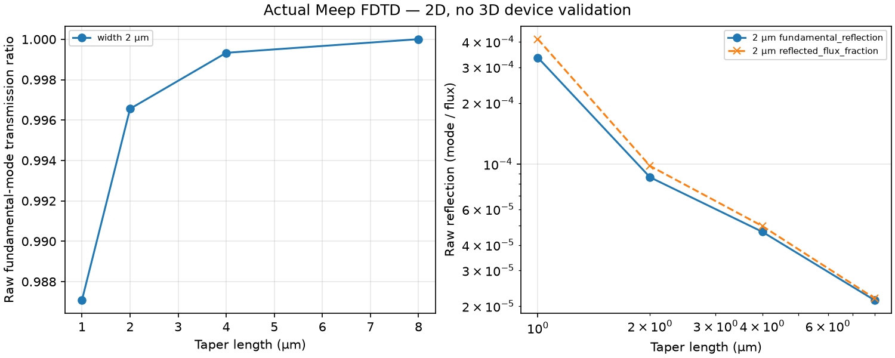
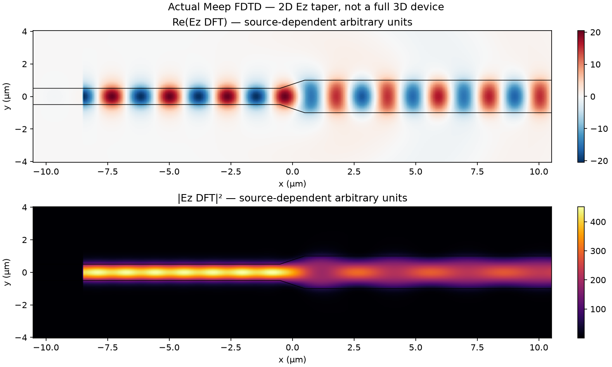
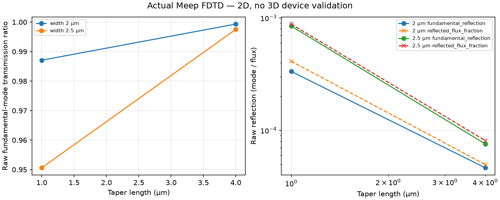

# Actual Meep 2D run examples

These files were generated by actual serial PyMeep **1.35.0**, Python **3.11.17**, on Linux x86-64 in a conda-forge environment on 2026-10-11. No FDTD values or field arrays were invented. The existing `../convergence.png` and `../datasets/` remain separate synthetic examples.

**Scope:** nondispersive epsilon=12 guide in air, 2D Ez polarization, wavelength 6.67 µm. These are unvalidated numerical examples, not measured device efficiencies or full 3D silicon photonics predictions. Source-dependent DFT fields are in arbitrary units.

## Official tutorial reproduction

[tutorial/sweep.json](tutorial/sweep.json) contains all four completed runs at resolution 25 pixels/µm. Input and output widths are 1 and 2 µm. The native upstream script was separately downloaded and executed in the same environment. Its reflection outputs match our backend's reflection values at its printed eight-decimal precision for lengths 1, 2, 4, and 8 µm. This verifies reproduction of the same numerical setup, not independent physical accuracy or convergence.

| Taper length (µm) | Fundamental T (raw) | Fundamental R | Accepted score range |
| --- | --- | --- | --- |
| 1 | 0.9870870206 | 0.0003342466 | True |
| 2 | 0.9965580191 | 0.0000861242 | True |
| 4 | 0.9993290702 | 0.0000464685 | True |
| 8 | 1.0000051524 | 0.0000214261 | False |

The length-8 transmission ratio slightly exceeds unity. It is preserved raw and **rejected as an optimization score**, never clipped to 1. Other total-flux ratios can exceed unity too; consult each run's `numerical_warnings`. A score-range pass does not establish physical accuracy.





Full complex fields and their coordinates are in `tutorial/run-NNNN/fields.npz`; per-point solver settings/powers are in `result.json`. Field plots show Re(Ez) and |Ez|², not a calibrated intensity or 3D field.

## Length and width sweep integration

[width-length-sweep/sweep.json](width-length-sweep/sweep.json) contains lengths 1/4 µm and output widths 2/2.5 µm at resolution 25. These four fundamental-mode scores are within [0,1] and were fed through `CSVReplayBackend` and `TaperSweep` to produce the existing framework's optimization history. Matching cases from the earlier actual runs were reused rather than resimulated; full per-run results and fields accompany each case. CSV replay performs no interpolation.

The 4 µm / 2.5 µm point's total output-flux ratio is slightly above 1 even though its fundamental-mode score is in range. This numerical diagnostic is retained and flagged; the optimization history is not a validation claim.



## Rejected point and limited resolution checks

The first optimization-mode width sweep used lengths 1/4 µm and widths 1.5/2.5 µm. It stopped at the third point (4 µm, 1.5 µm), whose raw fundamental transmission was 1.0000563478. [rejected-width-length-sweep/](rejected-width-length-sweep/) retains the three completed points as an **incomplete diagnostic sweep** with no accepted optimizer history. It is not a completed four-point grid.

[resolution-check/](resolution-check/) reruns the 1 µm / 2 µm tutorial point at resolution 35. Fundamental transmission changed from 0.9870870206 (resolution 25) to 0.9869888066 (resolution 35), an absolute difference about 0.0000982. This is a limited sensitivity check, not a convergence certificate.

[rejected-point-resolution-check/](rejected-point-resolution-check/) reruns the 4 µm / 1.5 µm diagnostic at resolution 40. Fundamental transmission is 0.9999885286, but the reflected-flux fraction is -0.0065588222. The negative diagnostic is unphysical and needs investigation of normalization/discretization/monitor behavior before physical interpretation. It is preserved without sign correction or clipping. Its aggregate has no accepted optimizer history. The reflection plot uses a symmetric log axis so the negative value remains visible.

## Reproduce and inspect

```bash
conda env create -f environment-meep.yml
conda activate photonics-meep
python -m pip install --no-deps --no-build-isolation -e .
OPENBLAS_NUM_THREADS=1 OMP_NUM_THREADS=1 python -m photonics_optimization.meep_sweep \
  --lengths 1 2 4 8 --widths 2 --resolution 25 --diagnostics-only --output artifacts/tutorial
OPENBLAS_NUM_THREADS=1 OMP_NUM_THREADS=1 python -m photonics_optimization.meep_sweep \
  --lengths 1 4 --widths 2 2.5 --resolution 25 --output artifacts/width-length
photonics-analyze examples/meep/width-length-sweep/sweep.csv \
  --parameters taper_length_um output_width_um --data-kind fdtd_meep_2d_unvalidated
```

The tutorial diagnostic CSV deliberately includes its out-of-range raw transmission and therefore does not pass the strict [0,1] efficiency importer. Use its JSON for diagnosis rather than treating that row as an accepted efficiency.

For the exact Linux package builds used here, create an environment from [conda-linux-64-explicit.txt](conda-linux-64-explicit.txt); it is platform-specific. Dependency updates can change numeric values. [verification/official-script.log](verification/official-script.log) stores the executed upstream solver log, and [verification/tutorial-comparison.json](verification/tutorial-comparison.json) records differences and SHA-256 hashes of the source script and log. The source came from the official [mode-decomposition.py](https://github.com/NanoComp/meep/blob/master/python/examples/mode-decomposition.py). The comparator can be rerun with `scripts/verify_meep_tutorial.py` and that exact downloaded source.

The optional backend guide and limitations are in [docs/MEEP.md](../../docs/MEEP.md). No Lumerical or 3D device validation was performed.

## Executed tests

The ordinary Python environment passed 97 tests and skipped the three opt-in solver tests. In the installed Conda environment, all 100 tests passed with `RUN_MEEP_TESTS=1`, including actual straight-guide, taper/fields/CSV, and timeout checks. Remote GitHub CI is configured but is not claimed to have passed here.
